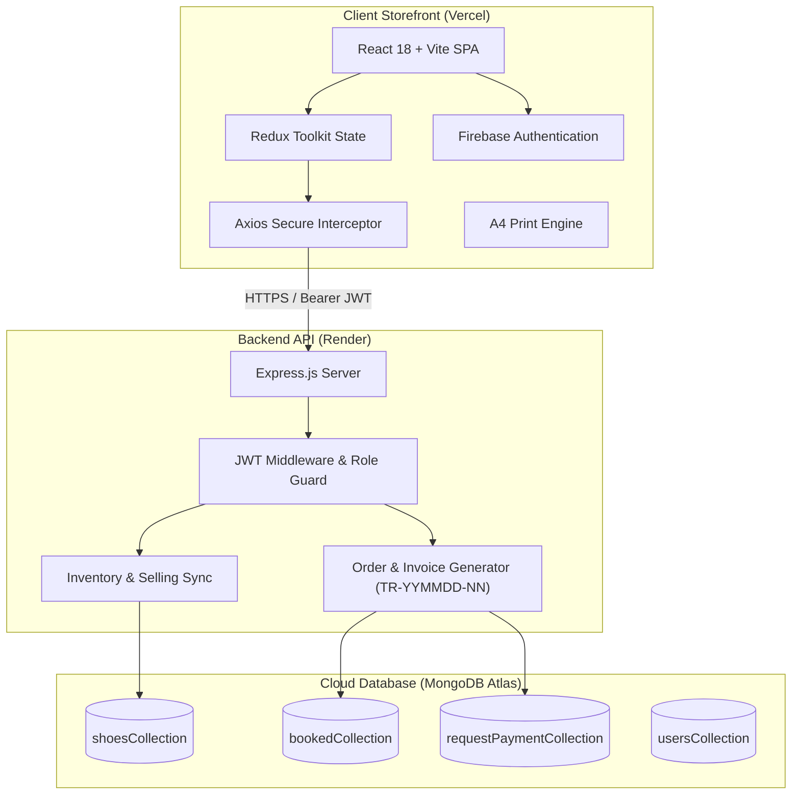

# 👞 Trends Shop — Luxury Leather Footwear Atelier

<div align="center">

  

  ### **A Bespoke MERN E-Commerce Experience for Fine Handcrafted Footwear**

  [](https://trends-shop-beta.vercel.app/)
  [](https://trends-shop.onrender.com/)
  [](https://react.dev/)
  [](https://vitejs.dev/)
  [](https://tailwindcss.com/)
  [](https://redux-toolkit.js.org/)
  [](https://www.mongodb.com/atlas)
  [](https://nodejs.org/)

  <p align="center">
    <a href="https://trends-shop-beta.vercel.app/"><b>Explore Live Atelier</b></a> •
    <a href="https://trends-shop.onrender.com/"><b>Inspect API Health</b></a> •
    <a href="#-key-architectural-features"><b>Key Features</b></a> •
    <a href="#-tech-stack"><b>Tech Stack</b></a> •
    <a href="#-local-setup-guide"><b>Local Setup</b></a>
  </p>

</div>

---

## 🌟 Executive Summary

**Trends Shop** is a high-end, production-grade leather footwear e-commerce application engineered with the **MERN** stack (MongoDB, Express, React, Node.js). Inspired by European heritage shoemakers and bespoke ateliers, it seamlessly blends timeless luxury visual aesthetics with modern, resilient software engineering.

The platform is designed to provide an unforgettable client journey: from high-resolution image zoom and ergonomic size selection, to **unified multi-article cart checkouts with single flat-rate delivery fees**, automated **`TR-YYMMDD-NN` invoice generation**, and **one-click A4 printable packing slips**.

---

## 🔗 Live Deployments

| Component | Cloud Host | Live Endpoint | Status |
| :--- | :--- | :--- | :---: |
| **Client Storefront** | **Vercel** | [https://trends-shop-beta.vercel.app](https://trends-shop-beta.vercel.app/) |  |
| **RESTful API Server** | **Render** | [https://trends-shop.onrender.com](https://trends-shop.onrender.com/) |  |
| **Database Cluster** | **MongoDB Atlas** | Dedicated Cloud Replica Set |  |

---

## ✨ Key Architectural Features

### 🛍️ 1. Unified Multi-Product Cart & Checkout
* **Multi-Item Order Consolidation**: Customers can acquire multiple pairs of footwear (e.g. 4 different styles across sizes) in a single checkout transaction without fragmented split payments.
* **Single Flat Delivery Charge**: Eliminates greedy per-item shipping fees. Applies a flat rate of **৳60 (Inside Dhaka)** or **৳120 (Outside Dhaka)** across the entire parcel, regardless of item quantity.
* **Smart Bag Counter & Pulse Badge**: The navigation header and user portal display real-time shopping bag counter badges with instant checkout routing.

### 🧾 2. Consolidated A4 Printable Invoices (`TR-YYMMDD-NN`)
* **Standardized Invoice Identification**: Server assigns atomic unique invoice codes (e.g., `TR-261031-01`) upon order placement.
* **A4 Print Engine (`window.print()`)**: Built-in `@media print` CSS stylesheet automatically hides navigation bars, overlays, and buttons, allowing clients and admins to print or save crystal-clear, professional PDF invoices on standard A4 paper.
* **Itemized Billing Breakdown**: Displays line-item product thumbnails, leather category, shoe size, quantity, unit price, flat courier fee, promo discounts, and payment transaction IDs.

### ⏳ 3. Smart Non-Blocking Luxury Loader
* **Dual-Orbital Amber Spinner**: Custom-crafted orbital gold ring loader featuring a center `TS` monogram badge and ambient radiance, aligning with the brand's identity.
* **Zero UI Flicker (Anti-Blocking Architecture)**: Preserves existing UI state during background cache re-fetching; never unmounts active pages when cached data is already present.
* **Safety Watchdog Timer**: Incorporates a 6.5-second fallback button (*"Taking longer than usual? Refresh Page"*) to safeguard clients against network drops or frozen connections.

### 🛡️ 4. Enterprise Security & JWT Integrity
* **Synchronous Token Interceptors**: Zero race-condition `useAxiosSecure` singleton interceptor preventing false `401/403` crashes on page reloads.
* **Role-Based Routing**: Strict `<AdminRoute />` and `<PrivateRoute />` wrappers ensuring unauthorized users cannot access executive consoles.
* **Sanitized Price Verification**: Subtotals and order values are verified against active catalog prices on the backend before finalizing orders.

### 📊 5. Executive Admin Intelligence & Operations
* **Order Progression Management**: Seamless status lifecycle transitions (*Awaiting Verification ➔ Payment Confirmed ➔ Dispatched / Delivery ➔ Completed*).
* **Inventory & Selling Sync**: Automatically decrements product stock and increments best-seller counts upon delivery dispatch.
* **Cart Intelligence & Custom Offers**: Identifies abandoned customer shopping bags and allows managers to issue targeted promo discount coupons directly.

---

## 🏛️ System Architecture



---

## 💻 Tech Stack

### Frontend Ecosystem
* **Core**: React 18.3, Vite 5.4, JavaScript (ES2023)
* **Styling**: TailwindCSS 3.4, PostCSS, Autoprefixer, Custom Luxury HSL Tokens
* **State Management**: Redux Toolkit (`@reduxjs/toolkit`), React-Redux
* **Routing**: React Router DOM v6 (Data Router with SPA `vercel.json` rewrites)
* **Server State & Caching**: TanStack React Query v5
* **Authentication**: Firebase Authentication v10
* **Icons & Animation**: React Icons (`fi`, `ri`, `tb`, `ai`), Custom CSS Keyframes
* **Notifications**: Bespoke `LuxuryToast` (Amber/Gold Glassmorphism)

### Backend Ecosystem
* **Runtime**: Node.js (v18 / v20 LTS)
* **Framework**: Express.js 4.21
* **Database Driver**: MongoDB Native Driver 6.9
* **Authentication**: JSON Web Tokens (`jsonwebtoken`), Cryptographic Verification
* **CORS & Middleware**: Express JSON Parser, CORS Middleware
* **Hosting Platform**: Render (Web Service Container, Singapore Region)

---

## 📁 Repository Structure

```
Trends-Shop/
├── Client/                         # Frontend React + Vite Application
│   ├── public/                     # Static assets and icons
│   ├── src/
│   │   ├── Components/
│   │   │   ├── Dashboard/          # Sidebar, tables, navigation widgets
│   │   │   ├── Design/             # LuxuryProductCard, LoadingSpinner
│   │   │   ├── Hooks/              # useAuth, useAdmin, useAxiosSecure
│   │   │   ├── Invoice/            # InvoiceModal.jsx (A4 Print Engine)
│   │   │   └── Toast/              # LuxuryToast.jsx (Gold notifications)
│   │   ├── Layouts/                # MainLayout, Dashboard
│   │   ├── Pages/                  # Products, ProductDetails, Checkout, MyOrders
│   │   ├── Provider/               # AuthProvider, ThemeContext, FavoritesContext
│   │   ├── Router/                 # Router.jsx, AdminRoute, PrivateRoute
│   │   └── index.css               # Core design system & keyframe animations
│   ├── vercel.json                 # Vercel SPA rewrite rules (No 404s)
│   └── package.json
│
├── Server/                         # Backend Express + Node.js API
│   ├── index.js                    # Core server routes & MongoDB Atlas endpoints
│   ├── seed_45_shoes.js            # Catalog seeders with full-grain leather assets
│   ├── package.json
│   └── .env.example                # Server environment schema
└── README.md
```

---

## 🛠️ Local Setup Guide

Follow these steps to run the application locally on your machine:

### Prerequisites
* **Node.js** (v18.x or v20.x recommended)
* **Git** installed
* Active **MongoDB Atlas** cluster or local MongoDB instance

### 1. Clone the Repository
```bash
git clone https://github.com/programmer-kabir/Trends-Shop.git
cd Trends-Shop
```

### 2. Configure Backend Server
```bash
cd Server
npm install
```

Create a `.env` file inside the `Server/` directory:
```env
DB_USER=your_mongodb_username
DB_PASS=your_mongodb_password
ACCESS_TOKEN=your_jwt_secret_token_here
PORT=5000
```

Start the backend development server:
```bash
node index.js
# Or: npm start
```
*Server will listen on: `http://localhost:5000`*

### 3. Configure Frontend Client
In a new terminal window:
```bash
cd Client
npm install
```

Create a `.env` file inside the `Client/` directory:
```env
VITE_LOCALHOST_KEY=http://localhost:5000
```

Start the Vite development server:
```bash
npm run dev
```
*Storefront will launch at: `http://localhost:5173`*

---

## 📡 Essential API Reference

| Method | Endpoint | Access | Description |
| :--- | :--- | :---: | :--- |
| `GET` | `/` | Public | Server health confirmation (`Server is Ok!`) |
| `GET` | `/shoes` | Public | Retrieve curated catalog of handcrafted footwear |
| `GET` | `/categories` | Public | Retrieve luxury footwear categories & collections |
| `POST` | `/jwt` | Public | Issue signed JSON Web Token upon Firebase login |
| `GET` | `/booked?email=...` | User | Retrieve current shopping bag items for active client |
| `POST` | `/requestPayment` | User | Submit unified order with flat shipping & generate invoice |
| `PATCH` | `/requestPayment` | Admin | Update order status and sync inventory counts |
| `GET` | `/userBookedData` | Admin | Retrieve abandoned customer carts for intelligence |

---

## 👨‍💻 Author & Acknowledgements

Crafted with passion for fine footwear and modern web architecture:

* **Lead Engineer**: [Programmer Kabir](https://github.com/programmer-kabir)
* **GitHub Repository**: [Trends-Shop](https://github.com/programmer-kabir/Trends-Shop)
* **Inquiries & Collaborations**: [programmerkabirr@gmail.com](mailto:programmerkabirr@gmail.com)

---

<div align="center">
  <sub>© 2026 Trends Shop Atelier. All rights reserved. Built with pride using the MERN Stack.</sub>
</div>